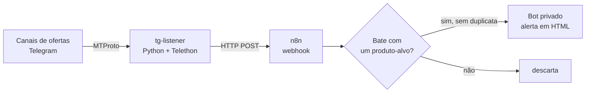

# Black Friday Deal Radar

Radar pessoal de ofertas: escuta canais de promoção no Telegram, cruza cada post com uma lista de
produtos-alvo e manda um alerta formatado para um bot privado assim que algo relevante aparece.

> **Status**: em construção. Fase 0 (infraestrutura e backup) concluída.

## Como funciona

## Stack

| Camada | Tecnologia |
|---|---|
| Coleta | Python 3.12 + [Telethon](https://github.com/LonamiWebs/Telethon) (MTProto, conta pessoal) |
| Orquestração e regras | n8n Community Edition, instância dedicada |
| Notificação | Telegram Bot API |
| Infraestrutura | Docker Compose numa VM Ubuntu 22.04 (VirtualBox) |

Tudo open source, rodando em hardware próprio.
