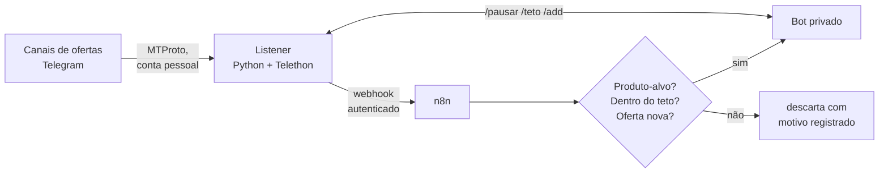

# Black Friday Deal Radar

Radar pessoal de ofertas. Escuta canais de promoção do Telegram com a minha própria conta, cruza
cada post com uma lista de produtos-alvo e, quando algo dentro do orçamento aparece, manda um
alerta formatado para um bot privado: produto, preço, cupom, canal de origem e botões para abrir a
oferta ou o post original.

Tudo open source, rodando em hardware próprio, construído na semana anterior à Black Friday de 2026.

<p align="center">
  
  &nbsp;&nbsp;
  
</p>

## O problema

Canais de oferta publicam dezenas de posts por hora, de air fryer a pneu. Na Black Friday, as
ofertas boas dos poucos produtos que me interessam duram minutos e se perdem no meio do volume.
Silenciar os canais faz perder a oferta; deixar as notificações ligadas faz perder a paciência.

O radar inverte isso: os canais ficam mudos e só o que importa vira notificação.

## Como funciona



Um listener em Python recebe cada post em tempo real e o entrega a uma instância dedicada do n8n,
onde ficam as regras: identificar o produto, extrair preço, cupom e link, descartar o que passa do
teto, deduplicar e formatar o alerta. O mesmo bot que alerta também recebe comandos para ajustar o
catálogo pelo celular durante a Black Friday.

## Decisões técnicas

**Leitura via MTProto.** O nó de Telegram do n8n usa a Bot API, e bots só leem canais que
administram. Para ler canais de terceiros com a própria conta é preciso o protocolo dos apps
oficiais, implementado pelo Telethon. O listener foi mantido simples: escuta só os canais
cadastrados, transforma cada post em JSON e entrega. Toda decisão de negócio fica no workflow, onde
é visível e editável.

**Instância n8n isolada.** A VM já hospedava outra instância n8n, de um projeto independente. Este
projeto ganhou um Compose próprio, com rede, volumes, banco e credenciais separados, reaproveitando
a mesma imagem por uma tag local fixa: custo zero de disco, e um upgrade do outro projeto não altera
esta stack. Antes de qualquer mudança na VM, a instância existente teve backup completo verificado
por checksum.

**Texto anti-cópia.** Um dos canais insere caracteres invisíveis (U+2060, *word joiner*) no meio
das palavras: `iPh⁠one` parece normal na tela, mas quebra qualquer busca textual. Isso só apareceu
ao rodar o motor contra posts reais, e sem o tratamento o radar seria cego para metade das fontes.

**Motor de matching declarativo.** Cada produto é uma regex de modelo com restrições: variantes
excluídas logo depois do modelo (S26 Ultra, iPhone 17 Pro), termos obrigatórios (A57 só com
256 GB), tamanho de tela, preço mínimo para descartar acessórios e teto de orçamento. O preço
efetivo considera à vista e total parcelado, e ignora valores de cupom, cashback e o preço antigo
de "de R$ X por R$ Y".

**Deduplicação por produto e preço.** Os dois canais repostam a mesma oferta, cada um com seu link
de afiliado. A chave de dedup é produto + preço arredondado, que se mantém entre canais, com janela
de 12 horas.

**Corte de tempo.** Ao voltar de uma queda, o listener recupera os posts perdidos. Posts com mais de
60 minutos são descartados, para não alertar oferta que provavelmente já esgotou.

**Comandos sem URL pública.** O gatilho de Telegram do n8n exige um endpoint HTTPS público, e esta
instância só escuta dentro da VM. O listener também loga como o bot, recebe os comandos por MTProto
e os repassa ao n8n. Só comandos do dono são aceitos; o resto é ignorado em silêncio.

**Healthcheck por batimento.** O listener avisa que está vivo a cada 5 minutos. Sem batimento por
15 minutos, o bot avisa; canais mudos por 3 horas em horário comercial também. Depois de um reboot
da VM, a primeira avaliação só recalibra, para não acusar queda num intervalo em que ninguém estava
olhando.

**Ciclo de vida com o Windows.** A VM liga no logon por tarefa agendada e desliga de forma limpa no
logoff (ACPI, com *savestate* de reserva). O cuidado vem de um incidente anterior nesta mesma VM: um
desligamento abrupto abortou o journal do ext4 e remontou o disco como somente leitura.

## Validação

- **93 testes** no harness local, executando exatamente o código que roda dentro dos nós do n8n:
  matching, preço, cupom, link, dedup, healthcheck em linha do tempo simulada e comandos do bot.
- **Corpus real:** o motor foi rodado contra cerca de 800 posts dos dois canais. Todo post que citava
  modelos parecidos com os alvos foi conferido manualmente, sem nenhum falso negativo: TVs de 65",
  A57 de 128 GB em combo, S26 FE, iPhone 17e e Edge 70 Pro e Fusion foram corretamente descartados.
- **Ponta a ponta:** webhook com e sem token, entrega real no bot, reboot completo da VM com retorno
  automático de todos os serviços.

```
node n8n/tests/run.mjs                 # 93/93 casos passaram
node n8n/tests/run.mjs --preview       # mostra cada alerta como chega no bot
node n8n/tests/run.mjs corpus.jsonl    # roda posts reais e resume o que alertaria
```

## Stack

| Camada | Tecnologia |
|---|---|
| Coleta | Python 3.12, [Telethon](https://github.com/LonamiWebs/Telethon), httpx |
| Regras e orquestração | n8n Community Edition (Code nodes em JavaScript) |
| Notificação e comandos | Telegram Bot API e MTProto |
| Infraestrutura | Docker Compose, Ubuntu 22.04 em VirtualBox, Windows Task Scheduler |
| Qualidade | harness Node.js, style check em CI (GitHub Actions) |

## Estrutura

```
├── listener/radar/      # listen.py, extract.py, login.py, backfill.py
├── n8n/
│   ├── code/            # código dos Code nodes (fonte de verdade, testado)
│   ├── tests/           # harness + fixtures com formatos reais dos canais
│   ├── build-workflow.mjs
│   └── workflows/       # JSON gerado, com placeholders no lugar de IDs reais
├── deploy/              # docker-compose, deploy do workflow, scripts do Windows
└── docs/                # arquitetura e operação
```

## Segurança

- Nenhum segredo no repositório: tokens, chaves e IDs vivem no `.env` da VM (permissão 600) e nas
  credenciais criptografadas do n8n. O JSON versionado do workflow usa placeholders, trocados no
  deploy.
- A sessão do Telethon dá acesso à conta do Telegram; ela nunca sai do volume Docker da VM e pode
  ser revogada em *Configurações > Dispositivos*.
- Editor e webhooks escutam só em `127.0.0.1` da VM. O acesso ao editor é por túnel SSH, e cada
  webhook exige um header de autenticação.

## Documentação

- [Arquitetura](docs/architecture.md): fluxo completo e o porquê de cada componente.
- [Desenvolvimento e operação](docs/DEVELOPMENT.md): subir do zero, mudar regras, comandos do bot,
  healthcheck e problemas conhecidos.

Projeto pessoal, sem fins comerciais.
