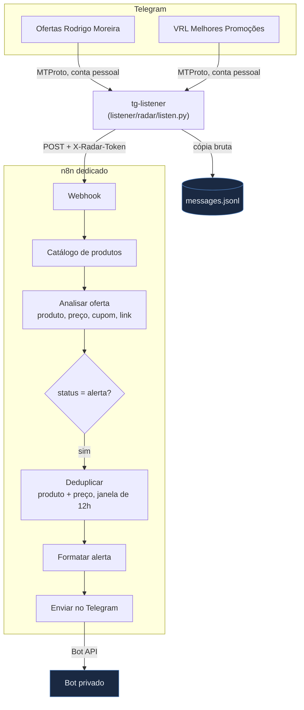

# Arquitetura

## Fluxo de ponta a ponta

## Por que um listener separado

O nó Telegram do n8n usa a Bot API, e um bot só lê canais em que é administrador. Ler canais de
terceiros com a própria conta exige o protocolo MTProto, que é o que os apps oficiais usam. O
Telethon implementa esse protocolo em Python.

O listener foi mantido propositalmente simples: escuta só os canais cadastrados, transforma cada
post em JSON (texto, links escondidos em texto, botões, trechos formatados como código) e entrega
ao n8n. Decidir se a oferta interessa é tarefa do workflow, onde a regra fica visível e editável.

## Recuperação do que foi perdido (retroativo)

O PC fica desligado à noite, e a VM às vezes volta de um estado salvo ou de um reset. A
recuperação não depende do `catch_up` do Telethon, que tem limites do lado do Telegram e não diz
quais posts chegaram atrasados. O listener mantém um estado próprio por canal em
`/data/cursor.json`:

| Campo | Quem avança | Para quê |
|---|---|---|
| `watermark` | só a reconciliação | ID até onde o canal já foi varrido |
| `seen` | ao vivo e reconciliação | IDs já entregues, para não duplicar |

A cada 2 minutos, e logo ao subir, a reconciliação pede ao Telegram os posts acima da
`watermark`, entrega os que não estão em `seen` com `replay: true` e só então avança a marca. Se o
ao vivo pudesse avançar a marca, um post novo chegando logo depois de uma reconexão empurraria a
marca para cima, e o intervalo perdido ficaria esquecido abaixo dela.

No n8n, um post com mais de 60 minutos é descartado, a menos que venha com `replay: true` e tenha
até 16 horas. Nesse caso vira alerta com a marca "⏪ Retroativo: postado em ..., pode ter esgotado".

## Por que uma instância n8n dedicada

A VM já hospedava uma instância n8n de outro projeto. Um workflow novo dentro dela funcionaria,
mas misturaria credenciais pessoais (sessão do Telegram, token do bot) com as do outro projeto e
acoplaria os dois ciclos de restart e upgrade. A stack `deal-radar` tem projeto Compose, rede,
volumes e banco próprios, e reaproveita a mesma imagem do n8n por uma tag local fixa. Com isso, o
custo em disco é zero e um upgrade do outro projeto não muda esta stack.

## Motor de matching

Cada produto do catálogo é uma regex do modelo mais restrições:

| Regra | Exemplo | Para quê |
|---|---|---|
| `excludeAfter` | S26 seguido de `ultra`, `plus`, `+`, `fe` | descarta variantes indesejadas |
| `requireAll` | `galaxy\|samsung`, `256gb` | exige termos combinados |
| `size` | `55` | TVs no tamanho certo |
| `minPrice` | 900 | abaixo disso é acessório (capa, película) |
| `maxPrice` | 5000 | teto de orçamento, parcelado conta pelo total |

O texto é normalizado antes (minúsculo, sem acento, sem pontuação exceto `+`) e os valores em reais
são removidos antes de procurar o tamanho, para que centavos como `,55` não virem "55 polegadas".

O preço efetivo é o menor valor plausível do post, à vista ou total parcelado. Valores ao lado de
"cupom", "OFF", "desconto" ou "cashback" são ignorados, assim como o preço antigo em "de R$ X por
R$ Y". Cada análise devolve um status (`alerta`, `acessorio`, `acima_do_teto`, `sem_produto`), que
aparece no histórico de execuções do n8n e explica por que um post não gerou alerta.

## Deduplicação

Os dois canais costumam repostar a mesma oferta, cada um com seu link de afiliado. A chave de dedup
é produto + preço arredondado, que se mantém entre canais, com janela de 12 horas. Sem preço
identificado, a chave cai para o link.

## Histórico de preços

O nó "Registrar preço" guarda, no static data do workflow, o preço de todo post que bateu com um
produto (alerta ou acima do teto), por até 45 dias e 300 registros por produto, sem repetir o mesmo
post. O comando `/historico` e o botão "📈 Histórico de preço" de cada alerta resumem esse registro:
ofertas vistas, menor, maior, mais recente e a variação em relação à primeira oferta e ao maior
preço da janela.

O botão usa `callback_data`. Como o n8n não recebe atualizações do bot (não há URL pública), quem
recebe o toque é o listener, que responde ao Telegram e repassa ao n8n como `/historico <id>`.

O histórico foi carregado retroativamente com os posts guardados desde 11/11, enviados com
`history_only: true`: passam pela análise sem o corte de idade e param no registro de preço, sem
gerar alerta.
